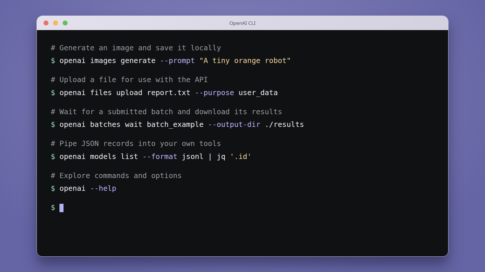

<div align="center">
  <h1>OpenAI CLI</h1>

  <p>The official command-line tool for the OpenAI REST API.</p>

  <p>
    <a href="#installation"><strong>Install</strong></a>
    ·
    <a href="docs/cli-reference.md">CLI reference</a>
    ·
    <a href="#guides">Guides</a>
  </p>
</div>

<!-- x-release-please-start-version -->

## Installation

One `openai` executable includes all CLI commands. Choose one installation method.

### Installing with Homebrew

On a Mac with Homebrew, paste this block into Bash or zsh.
Homebrew shows progress when it downloads the cask.

```sh
brew install --cask openai/tools/openai && {
  brew_bin="$(brew --prefix)/bin"
  export PATH="$brew_bin:$PATH"
  "$brew_bin/openai" --version
  command -v openai
}
```

This selects Homebrew for the current shell. If you configured a custom `--binarydir`, use that directory for `brew_bin`.
If new shells select another copy, add Homebrew's binary directory first in your shell profile.

To upgrade an existing Homebrew installation, refresh the tap and upgrade its cask.

```sh
brew update && brew upgrade --cask openai/tools/openai && {
  brew_bin="$(brew --prefix)/bin"
  export PATH="$brew_bin:$PATH"
  "$brew_bin/openai" --version
  command -v openai
}
```

If Homebrew says “already installed,” compare its cask version with the [latest CLI release](https://github.com/openai/openai-cli/releases/latest).
The tap can trail a release. Reinstalling the same cask gives you the same version.
Wait for the tap update or use the [prebuilt archive](#installing-a-prebuilt-binary) without installing Go.
In Bash or zsh, check which copy your shell runs.

```sh
brew info --cask openai/tools/openai
type -a openai
openai --version
```

### Installing a prebuilt binary

Download the archive for your operating system and architecture from [GitHub Releases](https://github.com/openai/openai-cli/releases/latest).
Choose the macOS ZIP, Linux tarball, or Windows ZIP under **Assets**.
On a Mac, the filename ends in `macos_arm64.zip` for Apple silicon or `macos_amd64.zip` for Intel.
Extract the archive.
For a manual installation, place `openai` (`openai.exe` on Windows) in a directory on your `PATH`.
Run `openai --version` to verify it.

**Want automatic updates?** On macOS or Linux, place the official release binary at `$HOME/.openai/bin/openai`.
The updater requires a compatible GitHub CLI (`gh`) and interactive launches.
See [automatic updates](docs/automatic-updates.md) for permissions, version pins, and opt-outs.
Homebrew and Go manage their own installations.

### Installing with Go

With [Go 1.26 or later](https://go.dev/doc/install), paste this block into Bash or zsh.
It installs the latest CLI and puts Go’s binary directory ahead of older copies.

```sh
printf '%s\n' 'Installing the latest OpenAI CLI with Go...'
go install github.com/openai/openai-cli/cmd/openai@latest && {
  go_bin=$(go env GOBIN)
  if [ -z "$go_bin" ]; then
    go_path=$(go env GOPATH)
    go_bin="${go_path%%:*}/bin"
  fi
  export PATH="$go_bin:$PATH"
  "$go_bin/openai" --version
  command -v openai
}
```

Go can finish silently. Add `-v` after `install` to show each package as it compiles.
For new shells, add the same PATH setup to your shell profile.

On Windows, run `go install github.com/openai/openai-cli/cmd/openai@latest`.
Add the Go binary directory to your user `Path`. Use `where.exe openai` to find installed copies.

<!-- x-release-please-end -->

<p align="center">
  
</p>

Call the OpenAI REST API from your terminal or shell scripts. Generate images, upload
files, submit batches, and inspect API results without writing an application.

> [!NOTE]
> **OpenAI CLI or Codex CLI?** Use `openai` when you want to call a specific API
> or put API operations in a script. Use [Codex CLI](https://developers.openai.com/codex/cli)
> (`codex`) when you want a coding agent to work on a project: read and edit code,
> run commands, and help implement or debug a change.

## Things to try

These examples require [authentication](#authentication).

### Generate an image and save it locally

```sh
openai images generate --prompt "A tiny orange robot watering a houseplant"
```

Images are saved to `~/Downloads/gpt-images/`, and the command prints their paths.
Use `--output-dir` for an existing destination directory or `--name` for a filename.
Supported terminals can preview the result. See the [image guide](docs/image-generation-saving.md)
for editing, model selection, and preview settings.

### Upload a file and retrieve it later

```sh
openai files upload report.txt --purpose user_data
openai files get file-example
openai files download file-example --output downloaded-report.txt
```

Use your own local file and replace `file-example` with the ID returned by the upload.
See [working with files](docs/files.md) for more examples.

### Run requests in a batch

Submit a JSONL request file, then wait for the batch and download its results:

```sh
openai files upload requests.jsonl --purpose batch
openai batches create --input-file-id file-example \
  --endpoint /v1/responses --completion-window 24h
openai batches wait batch_example --output-dir ./results
```

Replace the file and batch IDs with the returned IDs. The [batch guide](docs/batches.md)
includes a sample `requests.jsonl` and explains result files and failed requests.

### Export API data for a script

```sh
openai models list --format jsonl | jq '.id'
openai files list --format json > files.json
```

Choose `--format json` for a JSON document or `--format jsonl` for records.
The default output is readable text, **even in pipes**. The first example uses
[jq](https://jqlang.org/).

## Authentication

Run the setup guide to enter your API key safely:

```sh
openai help setup
```

For scripts, supply `OPENAI_API_KEY` through your environment or secret manager.
Create a key in [API settings](https://platform.openai.com/settings/organization/api-keys).

Try a request:

```sh
openai responses create \
  --model gpt-5.5 \
  --input "Say this is a test"
```

Admin endpoints use `OPENAI_ADMIN_KEY`, a separate
[admin API key](https://platform.openai.com/settings/organization/admin-keys).
For example, retrieve one day of organization usage:

```sh
openai admin organization usage completions \
  --start-time 1735689600 \
  --end-time 1735776000 \
  --bucket-width 1d
```

## Usage

Commands follow the API's resources:

```sh
openai <resource> [subresource...] <command> [flags...]
```

Browse commands and options with help. Help needs no API key or network connection.

```sh
openai --help
openai images generate --help
openai admin organization --help
```

`openai help COMMAND` and `openai COMMAND --help` show the same page.
Existing colon-separated commands, such as `openai admin:organization:usage completions`,
also work.

### Output and errors

Successful JSON responses display readable text by default. Select a data format
explicitly when parsing results. Use `--transform` to extract fields with
[GJSON syntax](https://github.com/tidwall/gjson/blob/master/SYNTAX.md):

```sh
openai files get file-example --transform filename --raw-output
```

Errors go to stderr as readable summaries. Use `--format-error json` for API error
details, or `--transform-error` to extract error fields. Explicit `--format json`,
`jsonl`, `raw`, and `yaml` also apply to errors unless `--format-error` overrides
them; `--format-error text` restores summaries. API error details and `--debug`
logs can contain sensitive data: sanitize them before sharing.

`--debug` adds per-attempt HTTP timing. Add `--debug-body` for redacted JSON
previews or `--debug-sse --debug-event-timing` for bounded stream diagnostics.
See [HTTP debugging](docs/debugging.md) for capture limits and timing boundaries.

Check the command's exit status before using redirected results; a failed request
can leave an incomplete output file. See [reading command results](docs/readable-output.md)
for list formats, streaming, binary downloads, and error behavior.

### File input

Binary uploads take a plain path. JSON input flags can read a value from a local
file with `@path`:

```sh
openai files upload report.txt --purpose user_data
openai responses create --model gpt-5.5 --input @prompt.txt
```

Use `OPENAI_UNTRUSTED_STDIN=1` when piping JSON or YAML from an untrusted source
so input cannot cause local file reads. In that mode, provide upload paths
explicitly as flags. See [file arguments and encoding](docs/cli-reference.md#passing-files-as-arguments)
for escaping literal `@` values, JSON/YAML input, and text or base64 encoding.

### Shell shortcuts

Set up [shell completion](docs/shell-completion.md) to complete commands and file
paths. [Command insertion](docs/command-insertion.md) lets you search examples
with Ctrl+X, then Tab and insert them without running them.

The first eligible interactive run saves image-picker Tab shortcuts for future
Bash, zsh, and fish sessions. Open a new terminal to use them. See
[setup and removal](docs/image-picker-shell-setup.md) for requirements and opt-out.
In PowerShell, press Enter after `openai images generate` to open the picker.

## Guides

| Task | Guide |
| --- | --- |
| Generate, edit, save, and preview images | [Images](docs/image-generation-saving.md) |
| Upload and download files | [Files](docs/files.md) |
| Submit batches and collect results | [Batches](docs/batches.md) |
| Create vector stores, upload files, and search | [Vector stores](docs/vector-store-workspace.md) |
| Generate speech and work with audio | [Audio](docs/audio-workbench.md) |
| Inspect and count tokens locally | [Tokenizer](docs/local-utilities.md) |
| Test webhook handling | [Webhooks](docs/webhook-testing.md) |
| Parse results in scripts | [Output formats](docs/readable-output.md) |
| Configure headers, mTLS, and file input | [CLI reference](docs/cli-reference.md) |

> [!TIP]
> **Managing OpenAI resources with Terraform?** Use the official
> [OpenAI Terraform provider](https://github.com/openai/terraform-provider-openai)
> to manage projects, service accounts, rate limits, and other supported resources
> as infrastructure as code.

## Development

`scripts/run` is a development helper for running the CLI from a cloned checkout:

```sh
./scripts/run --help
```

See the [development instructions](CONTRIBUTING.md#running-and-building-locally)
for its dependency, credential, path, and exit-status behavior.

To test against another OpenAI Go SDK version, use `./scripts/link`:

```sh
./scripts/link github.com/org/repo@version
./scripts/link ../path/to/openai-go
```

With no arguments, it uses `../openai-go`. See [CONTRIBUTING.md](CONTRIBUTING.md)
for setup, checks, and repository structure.

## Contributing

Please share bug reports and feature requests through [GitHub issues](https://github.com/openai/openai-cli/issues).
Pull requests are limited to repository collaborators; we do not accept pull requests from non-collaborators.
See [CONTRIBUTING.md](./CONTRIBUTING.md) for the contribution policy and development guide.
See the [security model](docs/architecture/security-model.md) for trust boundaries.
For security vulnerabilities, follow [SECURITY.md](SECURITY.md).

## License

Copyright 2026 OpenAI

This project is licensed under the [Apache License 2.0](LICENSE).
