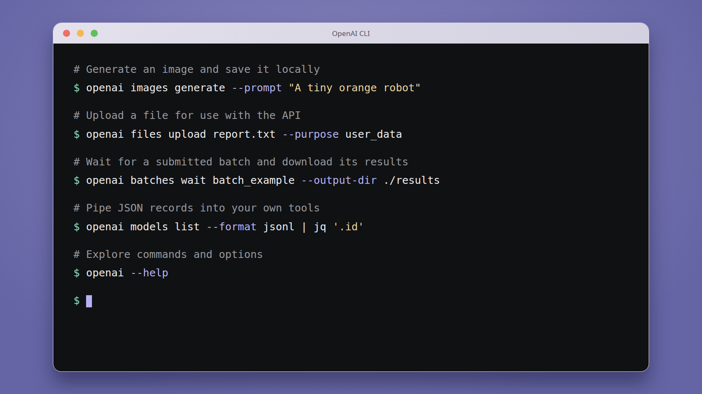

<div align="center">
  <h1>OpenAI CLI</h1>

  <p>The official command-line tool for the OpenAI REST API.</p>

  <p>
    <a href="#installation"><strong>Install</strong></a>
    ·
    <a href="docs/cli-reference.md">CLI reference</a>
    ·
    <a href="#guides">Guides</a>
  </p>
</div>

<p align="center">
  
</p>

Call the OpenAI REST API from your terminal or shell scripts. Generate images, upload
files, submit batches, and inspect API results without writing an application.

> [!NOTE]
> **OpenAI CLI or Codex CLI?** Use `openai` when you want to call a specific API
> or put API operations in a script. Use [Codex CLI](https://developers.openai.com/codex/cli)
> (`codex`) when you want a coding agent to work on a project: read and edit code,
> run commands, and help implement or debug a change.

## Things to try

These examples use an API key; see [installation](#installation) and
[authentication](#authentication) below.

### Generate an image and save it locally

```sh
openai images generate --prompt "A tiny orange robot watering a houseplant"
```

Images are saved to `~/Downloads/gpt-images/`, and the command prints their paths.
Use `--output-dir` for an existing destination directory or `--name` for a filename.
Supported terminals can preview the result. See the [image guide](docs/image-generation-saving.md)
for editing, model selection, and preview settings.

### Upload a file and retrieve it later

```sh
openai files upload report.txt --purpose user_data
openai files get file-example
openai files download file-example --output downloaded-report.txt
```

Use your own local file and replace `file-example` with the ID returned by the upload.
See [working with files](docs/files.md) for more examples.

### Run requests in a batch

Submit a JSONL request file, then wait for the batch and download its results:

```sh
openai files upload requests.jsonl --purpose batch
openai batches create --input-file-id file-example \
  --endpoint /v1/responses --completion-window 24h
openai batches wait batch_example --output-dir ./results
```

Replace the file and batch IDs with the returned IDs. The [batch guide](docs/batches.md)
includes a sample `requests.jsonl` and explains result files and failed requests.

### Export API data for a script

```sh
openai models list --format jsonl | jq '.id'
openai files list --format json > files.json
```

Choose `--format json` for a JSON document or `--format jsonl` for records.
The default output is readable text, **even in pipes**. The first example uses
[jq](https://jqlang.org/).

<!-- x-release-please-start-version -->

## Installation

### Installing a prebuilt binary

Download the archive for your operating system and architecture from
[GitHub Releases](https://github.com/openai/openai-cli/releases/latest).
Binaries are available for macOS, Linux, and Windows. Extract the archive and
place `openai` (`openai.exe` on Windows) in a directory on your `PATH`.

### Installing with Homebrew

```sh
brew install openai/tools/openai
```

### Installing with Go

Requires [Go 1.26 or later](https://go.dev/doc/install).

```sh
go install 'github.com/openai/openai-cli/cmd/openai@latest'
```

Once you have run `go install`, the binary is placed in your Go bin directory:

- **Default location**: `$HOME/go/bin` (or `$GOPATH/bin` if GOPATH is set)
- **Check your path**: Run `go env GOPATH` to see the base directory

If commands aren't found after installation, add the Go bin directory to your PATH:

```sh
# Add to your shell profile (.zshrc, .bashrc, etc.)
export PATH="$PATH:$(go env GOPATH)/bin"
```

<!-- x-release-please-end -->

The CLI checks for updates on eligible interactive runs; it never installs them
automatically. Set `OPENAI_CLI_NO_UPDATE_CHECK=1` to disable checks and notices.
See [update notices](docs/cli-reference.md#update-notices) for details.

## Authentication

Run the setup guide to enter your API key safely:

```sh
openai help setup
```

For scripts, supply `OPENAI_API_KEY` through your environment or secret manager.
Create a key in [API settings](https://platform.openai.com/settings/organization/api-keys).

Try a request:

```sh
openai responses create \
  --model gpt-5.5 \
  --input "Say this is a test"
```

Admin endpoints use `OPENAI_ADMIN_KEY`, a separate
[admin API key](https://platform.openai.com/settings/organization/admin-keys).
For example, retrieve one day of organization usage:

```sh
openai admin organization usage completions \
  --start-time 1735689600 \
  --end-time 1735776000 \
  --bucket-width 1d
```

## Usage

Commands follow the API's resources:

```sh
openai <resource> [subresource...] <command> [flags...]
```

Browse commands and options with help. Help needs no API key or network connection.

```sh
openai --help
openai images generate --help
openai admin organization --help
```

`openai help COMMAND` and `openai COMMAND --help` show the same page.
Existing colon-separated commands, such as `openai admin:organization:usage completions`,
also work.

### Output and errors

Successful JSON responses display readable text by default. Select a data format
explicitly when parsing results. Use `--transform` to extract fields with
[GJSON syntax](https://github.com/tidwall/gjson/blob/master/SYNTAX.md):

```sh
openai files get file-example --transform filename --raw-output
```

Errors go to stderr as readable summaries. Use `--format-error json` for API error
details, or `--transform-error` to extract error fields. Explicit `--format json`,
`jsonl`, `raw`, and `yaml` also apply to errors unless `--format-error` overrides
them; `--format-error text` restores summaries. API error details and `--debug`
logs can contain sensitive data: sanitize them before sharing.

Check the command's exit status before using redirected results; a failed request
can leave an incomplete output file. See [reading command results](docs/readable-output.md)
for list formats, streaming, binary downloads, and error behavior.

### File input

Binary uploads take a plain path. JSON input flags can read a value from a local
file with `@path`:

```sh
openai files upload report.txt --purpose user_data
openai responses create --model gpt-5.5 --input @prompt.txt
```

Use `OPENAI_UNTRUSTED_STDIN=1` when piping JSON or YAML from an untrusted source
so input cannot cause local file reads. In that mode, provide upload paths
explicitly as flags. See [file arguments and encoding](docs/cli-reference.md#passing-files-as-arguments)
for escaping literal `@` values, JSON/YAML input, and text or base64 encoding.

### Shell shortcuts

Set up [shell completion](docs/shell-completion.md) to complete commands and file
paths. [Command insertion](docs/command-insertion.md) lets you search examples
with Ctrl+X, then Tab and insert them without running them.

The first eligible interactive run saves image-picker Tab shortcuts for future
Bash, zsh, and fish sessions. Open a new terminal to use them. See
[setup and removal](docs/image-picker-shell-setup.md) for requirements and opt-out.
In PowerShell, press Enter after `openai images generate` to open the picker.

## Guides

| Task | Guide |
| --- | --- |
| Generate, edit, save, and preview images | [Images](docs/image-generation-saving.md) |
| Upload and download files | [Files](docs/files.md) |
| Submit batches and collect results | [Batches](docs/batches.md) |
| Generate speech and work with audio | [Audio](docs/audio-workbench.md) |
| Inspect and count tokens locally | [Tokenizer](docs/local-utilities.md) |
| Test webhook handling | [Webhooks](docs/webhook-testing.md) |
| Parse results in scripts | [Output formats](docs/readable-output.md) |
| Configure headers, mTLS, and file input | [CLI reference](docs/cli-reference.md) |

> [!TIP]
> **Managing OpenAI resources with Terraform?** Use the official
> [OpenAI Terraform provider](https://github.com/openai/terraform-provider-openai)
> to manage projects, service accounts, rate limits, and other supported resources
> as infrastructure as code.

## Development

From a clone of this repository, run the CLI with:

```sh
./scripts/run --help
```

To test against another OpenAI Go SDK version, use `./scripts/link`:

```sh
./scripts/link github.com/org/repo@version
./scripts/link ../path/to/openai-go
```

With no arguments, it uses `../openai-go`. See [CONTRIBUTING.md](CONTRIBUTING.md)
for setup, checks, and repository structure.

## Contributing

Please share bug reports and feature requests through [GitHub issues](https://github.com/openai/openai-cli/issues).
Pull requests are limited to repository collaborators; we do not accept pull requests from non-collaborators.
See [CONTRIBUTING.md](./CONTRIBUTING.md) for the contribution policy and development guide.
For security vulnerabilities, follow [SECURITY.md](SECURITY.md).

## License

Copyright 2026 OpenAI

This project is licensed under the [Apache License 2.0](LICENSE).
